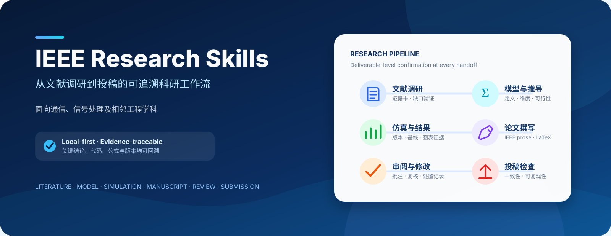
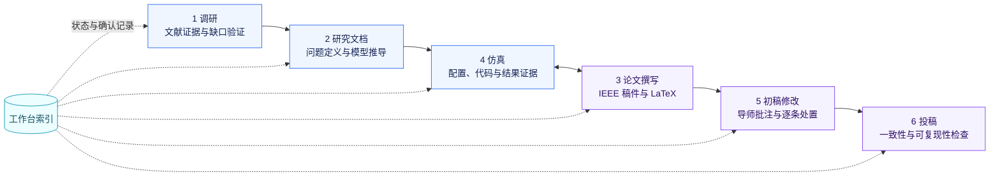
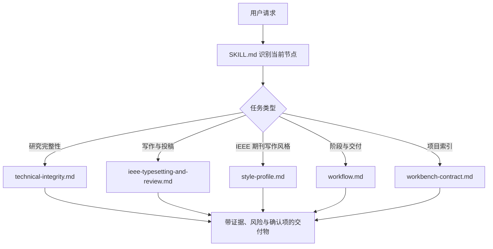

<p align="center">
  
</p>

<p align="center">
  <a href="SKILL.md"></a>
  <a href="assets/project_template"></a>
  <a href="references/technical-integrity.md"></a>
  
</p>

<p align="center">
  <strong>一个面向通信、信号处理及相邻工程学科的本地科研 Skill。</strong><br>
  把文献调研、研究缺口验证、模型与公式检查、仿真、论文撰写、导师批注修改和投稿前复核组织成可追溯的项目工作流。
</p>

---

## 为什么做这个 Skill

科研任务往往跨越数周甚至数月。仅依赖一段越来越长的聊天记录，很难保留材料版本、技术决策、仿真条件与修改依据。`IEEE Research Skills` 将项目目录作为事实来源，通过固定的阶段、模板、确认记录和技术检查，让 Agent 的每次输出都能回到具体文件与证据。

<table>
  <tr>
    <td width="33%" valign="top"><strong>📚 研究过程可追溯</strong><br><br>记录文献证据、研究缺口、公式检查、仿真配置和结论对应关系。</td>
    <td width="33%" valign="top"><strong>🔒 关键结论先确认</strong><br><br>研究缺口、模型、参数、结论和稿件修改不会在未经确认时进入项目正式状态。</td>
    <td width="33%" valign="top"><strong>🧭 从调研走到投稿</strong><br><br>同一套目录连接调研、研究文档、仿真、写作、初稿修改与投稿检查。</td>
  </tr>
</table>

## 工作流总览



> 允许回退，但必须记录“改了什么”和“哪些内容需要重新检查”。

## 核心能力

| 任务 | Skill 会做什么 | 主要留痕 |
|---|---|---|
| 文献调研 | 扩展检索、核对证据、验证研究缺口 | 调研证据卡、来源位置、待核实项 |
| 问题定义 | 明确研究目标、假设、约束和可验证指标 | 研究方案卡、确认记录 |
| 模型与推导检查 | 检查定义、维度、下标、共轭/转置、可行域和叙述一致性 | 公式推导检查单 |
| 仿真设计 | 固定代码版本、配置、随机种子策略、基线和指标 | 仿真记录、结果文件链接 |
| 结果解释 | 区分仿真观察、推断和待验证假设 | claim-to-figure 对应关系 |
| IEEE 稿件撰写 | 组织论证、保留 LaTeX 与引文标签、检查表述依据 | 稿件版本记录 |
| 导师批注处理 | 诊断批注意图、逐条修改、说明技术含义和后续复检 | 逐条修改记录 |
| 投稿前检查 | 检查一致性、引用、排版、可复现性与期刊适配 | 投稿前检查单 |

## 快速开始

### 1. 获取仓库

```bash
git clone https://github.com/liruoyan1225/IEEE-research-skills.git
```

将仓库目录放入你的 Agent/Skill 加载路径，并确保 `SKILL.md` 位于 Skill 根目录。以 Codex 为例，可放入：

```text
$CODEX_HOME/skills/ieee-research-skills/
```

> 不同 Agent 的 Skill 目录约定可能不同，请以对应产品文档为准。

### 2. 从一个明确入口开始

可以直接使用自然语言，也可以使用标准入口：

```text
建立项目
打开项目
开始调研
定义问题
检查模型与推导
设计仿真
解释仿真结果
撰写论文
处理导师批注
学术审阅
投稿前检查
```

### 3. 推荐的首次调用

```text
请使用 ieee-research-skills 为“RIS 辅助无线通信”建立一个研究项目。
先检查我现有的文献、代码和稿件材料，不要补造缺失信息。
输出项目结构、材料状态、待确认问题和下一步建议，等我确认后再推进。
```

Skill 会按以下顺序返回：

1. 材料状态与假设
2. 当前交付物
3. 证据与文件位置
4. 需要用户决定的事项
5. 自检结果与下一状态

## 项目目录

建立项目时，Skill 使用 [`assets/project_template/`](assets/project_template/) 作为模板：

```text
项目名称/
├─ 工作台索引/
│  ├─ project_index.json
│  ├─ 项目总览.md
│  ├─ 当前状态.md
│  ├─ 确认记录.md
│  └─ IEEE期刊写作风格档案.md
├─ 1_调研/
│  └─ 调研证据卡.md
├─ 2_研究文档/
│  ├─ 研究方案卡.md
│  └─ 公式推导检查单.md
├─ 3_论文撰写/
│  └─ 稿件版本记录.md
├─ 4_仿真/
│  └─ 仿真记录.md
├─ 5_初稿修改/
│  └─ 逐条修改记录.md
└─ 6_投稿/
   └─ 投稿前检查单.md
```

原始论文、代码、数据和稿件版本不会被模板替代。模板记录它们的位置、状态、版本和彼此关系。

## 按任务加载参考规则

Skill 不会把所有规则一次性塞入上下文，而是根据当前任务读取对应参考文件：

| 当前任务 | 读取的规则 |
|---|---|
| 阶段切换、交付和回退 | [`references/workflow.md`](references/workflow.md) |
| IEEE 期刊写作风格与语料维护 | [`references/style-profile.md`](references/style-profile.md)、[`references/ieee-journal-style-corpus.md`](references/ieee-journal-style-corpus.md) |
| 文献、模型、推导、仿真和结果 | [`references/technical-integrity.md`](references/technical-integrity.md) |
| 稿件、LaTeX、批注、审阅和投稿 | [`references/ieee-typesetting-and-review.md`](references/ieee-typesetting-and-review.md) |
| 项目建立与工作台集成 | [`references/workbench-contract.md`](references/workbench-contract.md) |



## 关键原则

- **项目文件优先**：项目目录和 `工作台索引/` 是事实来源，聊天历史不能替代正式记录。
- **交付物级确认**：每个节点都说明输入、假设、拟交付内容、风险和需要确认的决定。
- **不补造证据**：不虚构文献覆盖、研究缺口、参数、基线、结果、引文或实现状态。
- **结论可复查**：仿真结论保留代码版本、配置、随机种子策略、指标和结果文件。
- **风格从公开语料中学习**：写作规则由多篇 IEEE 代表性期刊论文交叉归纳，并保留 DOI、适用范围和证据映射。

## 适用范围

**适合：**

- 通信工程、信号处理及相邻工程学科
- 需要长期维护材料、版本和技术决策的研究项目
- IEEE 稿件写作、LaTeX 检查、导师批注修改与投稿复核
- 需要让 Agent 执行任务，同时保留研究者确认权的工作流

**不适合直接代替：**

- 研究者对课题方向、模型合理性和结果可信度的最终判断
- IEEE 官方模板、期刊 Author Guidelines 或投稿系统要求
- 未提供原始材料时的文献、数据、实验结果和引用生成

## 仓库结构

```text
IEEE-research-skills/
├─ SKILL.md                     # Skill 入口与核心约束
├─ agents/openai.yaml           # Agent 展示配置
├─ references/                  # 分任务加载的规则
├─ assets/project_template/     # 可复制的科研项目模板
└─ README.md                    # 项目介绍与使用指南
```

## 关于 IEEE 期刊写作风格档案

项目模板包含 `IEEE期刊写作风格档案.md`。默认风格不是对单一作者的模仿，而是从 IEEE JSAC、TWC、TCOM、TSP、Communications Surveys & Tutorials 和 Proceedings of the IEEE 的代表性论文中，归纳可迁移的工程论文写作规则：问题如何收束、贡献如何对应研究缺口、变量何时定义、优化问题如何解释、算法如何交代收敛性，以及仿真结论如何连接图表证据。

[`references/ieee-journal-style-corpus.md`](references/ieee-journal-style-corpus.md) 保存语料题录、DOI 和每篇论文的观察用途；[`references/style-profile.md`](references/style-profile.md) 保存蒸馏后的默认规则。新增论文只先形成带来源的候选规则，经过跨论文对照和用户确认后，才会改变默认风格。仓库不收录受版权保护的论文全文。

## License

仓库目前未包含开源许可证。未经作者明确许可，请勿假定可以复制、修改或重新分发仓库内容。

---

<p align="center">
  Maintained by <a href="https://github.com/liruoyan1225">@liruoyan1225</a><br>
  <sub>Research judgment stays with the researcher. The Skill keeps the process inspectable.</sub>
</p>

